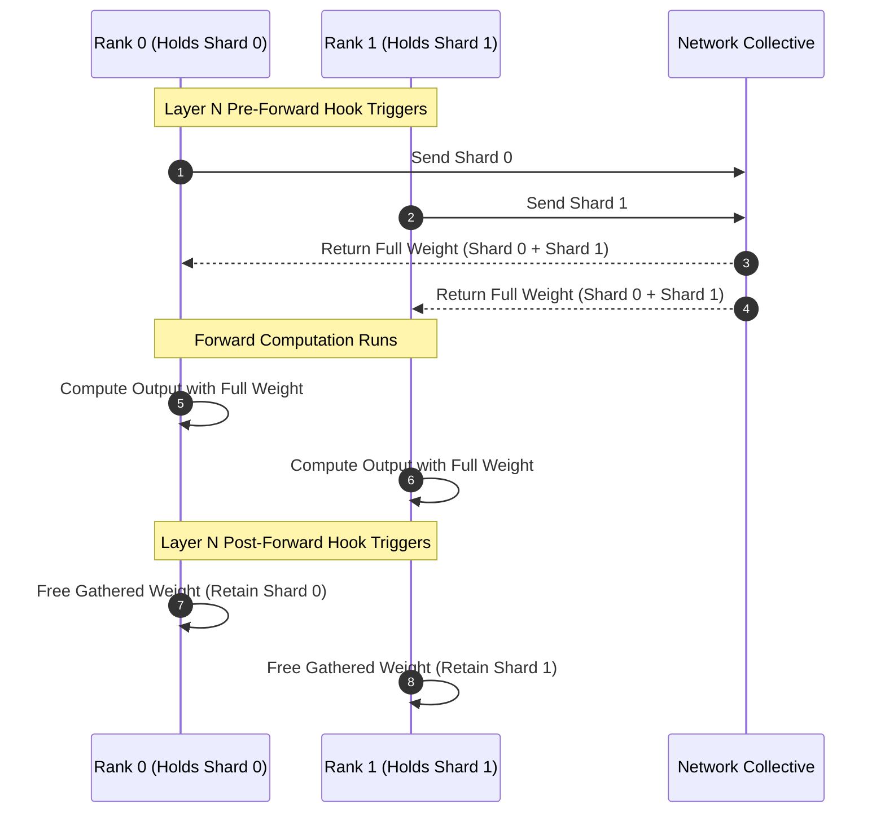
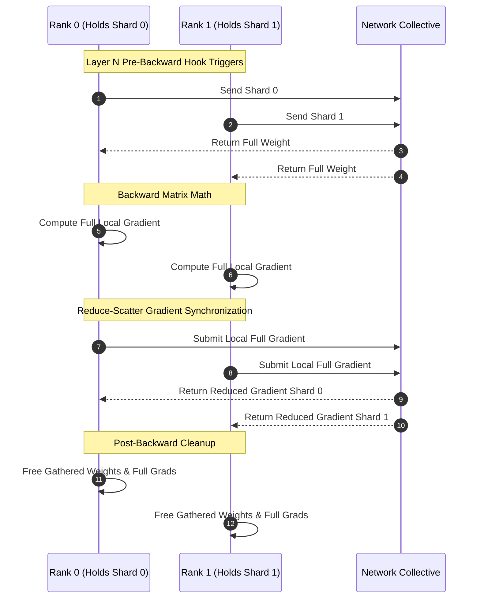

<p><h1 align="center">Conceptual FSDP & Lifecycle Mechanics</h1></p>

<br>

This document provides a deep dive into the theoretical foundation and execution mechanics of Fully Sharded Data Parallelism (FSDP). It explains the memory bottlenecks of standard data parallelism, how FSDP breaks through these limits, the exact step-by-step forward and backward lifecycles, and how FSDP1 differs from modern FSDP2.

<br>

## 1. The Memory Wall: DDP vs. FSDP

When training deep learning models at scale, GPU memory (or CPU RAM) is consumed by four primary components, often referred to as the **Model States**:

1. *Parameters* ($P$): Model weights being optimized.
2. *Gradients* ($G$): Derivatives computed during backward propagation.
3. *Optimizer* States ($O$): First and second momentum buffers (e.g., in Adam, which consumes $2 \times P$ memory).
4. *Activations* ($A$): Intermediate tensor values saved during the forward pass for gradient calculations.

### Distributed Data Parallel (DDP)

In standard Distributed Data Parallel (DDP), every rank holds an exact, full copy of the model parameters $P$ and optimizer states $O$. Each rank processes a distinct mini-batch of data, computes gradients $G$ locally, and performs an `All-Reduce` operation to average gradients across all ranks before updating parameters.

$$\text{Memory per rank (DDP)} \propto P + G + O + A$$

As model sizes grow into billions of parameters, storing full copies of $P$, $G$, and $O$ on every single device becomes mathematically impossible on single accelerators.

```text
DDP Memory Layout Across Ranks:
• Rank 0: [ Full Parameters ]   [ Full Gradients ]   [ Full Optimizer States ]   [ Local Batch Activations ]
• Rank 1: [ Full Parameters ]   [ Full Gradients ]   [ Full Optimizer States ]   [ Local Batch Activations ]
```

### Fully Sharded Data Parallel (FSDP)

FSDP eliminates this redundancy by sharding parameters $P$, gradients $G$, and optimizer states $O$ uniformly across all ranks in a distributed process group.

$$\text{Memory per rank (FSDP at rest)} \propto \frac{P}{N} + \frac{G}{N} + \frac{O}{N} + \frac{A}{N}$$

*(where* $N$ *is the total number of ranks)*

Instead of keeping full parameters persistent throughout training, FSDP fetches parameters on-demand right before they are needed for computation and discards them immediately afterward.

Notice that activations $A$ are divided by $N$. In data-parallel training, each rank processes its own distinct slice of the global batch (e.g., a local batch size of 2 out of a global batch size of 16 across 8 ranks). Because the forward pass processes only the local data shard on that rank, the resulting activation tensors residing in memory during forward and backward passes are naturally proportional to $A/N$.

```text
FSDP Memory Layout Across Ranks (Resting State):
• Rank 0: [ Parameter Shard 0 ]   [ Gradient Shard 0 ]   [ Optimizer State Shard 0 ]   [ Local Batch Activations ]
• Rank 1: [ Parameter Shard 1 ]   [ Gradient Shard 1 ]   [ Optimizer State Shard 1 ]   [ Local Batch Activations ]
```

<br>

## 2. Forward Pass Execution Lifecycle

Because parameters are sharded across ranks during idle states, a worker cannot compute a forward pass on a layer using only its local shard. The full parameter weights must be temporarily reconstructed on the fly.

### Step-by-Step Forward Flow

1. **Pre-Forward (All-Gather):** Before a submodule executes its forward method, a pre-forward hook triggers an `All-Gather` collective operation. Every rank sends its local parameter shard $P/N$ and receives all other shards, reconstructing the full un-sharded parameter tensor $P$ in local memory.
2. **Forward Computation:** The layer computes its forward matrix multiplication using the full parameter tensor $P$ and local input activations.
3. **Post-Forward (Immediate Freeing):** Immediately after the forward computation completes, a post-forward hook disposes of the gathered full parameters, freeing memory back to the allocator. Only the rank's original local shard $P/N$ is retained.



<br>

## 3. Backward Pass Execution Lifecycle

The backward pass mirrors the forward pass but introduces gradient synchronization. It follows a precise sequence to ensure correct gradient updates while maintaining low memory footprints. Because gradients require full parameters to be computed, parameters must be gathered a second time.

### Step-by-Step Backward Flow

1. **All-Gather Phase**: Since full parameter weights were freed immediately after the forward pass to save memory, they are no longer present on the device. Therefore, an all-gather runs again before the backward pass of each layer to supply the full parameters $P$ needed for gradient calculation.
2. **Local Gradient Computation:** The layer computes full gradients $G_{full}$ with respect to the input activations and un-sharded parameters.
3. **Reduce-Scatter Operation:** Instead of keeping full gradients, an explicit `Reduce-Scatter` operation is performed across all ranks:
   - Gradients are averaged/summed across ranks (`Reduce`).
   - The resulting averaged gradient is chunked into shards, and each rank receives only its assigned gradient shard $G/N$ (`Scatter`).
4. **Post-Backward Cleanup:** Un-sharded full parameters $P$ and un-sharded gradients $G_{full}$ are freed immediately. Only the local gradient shard $G/N$ remains attached to the local parameter shard $P/N$.



<br>

## 4. Lazy Optimizer State Sharding

A critical design advantage of FSDP is that optimizer states do not require dedicated communication or complex custom sharding logic during the optimizer step.

### How It Works

1. Standard PyTorch optimizers (such as Adam, AdamW, or SGD with momentum) initialize their state buffers lazily during the first call to `optimizer.step()`.
2. When `optimizer.step()` is invoked, the optimizer inspects the parameters registered to it. Under FSDP, the module parameters persistent on each rank outside of forward/backward passes are **already sharded local tensors** (or DTensor local shards).
3. The optimizer allocates state buffers (such as `exp_avg` and `exp_avg_sq` momentum tensors) matching the exact shape and size of the parameters passed to it.
4. Because the parameters are already sharded ($P/N$), the created optimizer states are **naturally and automatically sharded** ($O/N$).

Each rank updates its own local parameter shard using its local gradient shard and local optimizer state shard completely independently, requiring **zero cross-rank communication** during `optimizer.step()`.

```text
Rank 0 Local Memory:
  Parameter Shard (Shape: [128, 256])
  Gradient Shard  (Shape: [128, 256])
  --> optimizer.step() initializes:
  exp_avg         (Shape: [128, 256])  <-- Automatically Sharded!
  exp_avg_sq      (Shape: [128, 256])  <-- Automatically Sharded!
```

<br>

## 5. Architectural Comparison: FSDP1 vs. FSDP2

PyTorch has evolved through two distinct paradigms for implementing Fully Sharded Data Parallelism. Understanding this architectural evolution clarifies why `edufsdp` adopts modern distributed principles rather than legacy abstractions.

The first-generation approach, FSDP1, relies on a flat-parameter paradigm where all parameters within a module or nested block are concatenated and flattened into a single, massive 1D continuous tensor known as the `FlatParameter`. While effective for scaling large models, this flattening approach introduces significant trade-offs: it destroys individual parameter identities and names within the module hierarchy, complicating inspection, debugging, and integration with custom layers. Furthermore, state dictionary management requires complex remapping and un-flattening logic, and interoperability with other parallelism techniques like Tensor Parallelism becomes cumbersome because underlying weights are obscured inside opaque flat buffers.

To overcome these hurdles, PyTorch introduced FSDP2 - the modern standard built natively around distributed tensor abstractions (`DTensor`) and the `fully_shard` API. Instead of flattening tensors, FSDP2 preserves individual parameter boundaries and shapes by wrapping and sharding each `nn.Parameter` directly along dimension 0 using a `DeviceMesh` and native `Shard(0)` placements. This zero-flattening design ensures that original shapes and metadata remain intact, enabling clean autograd composition with Tensor and Pipeline Parallelism. This transparent, per-parameter sharding philosophy forms the exact foundation of `edufsdp`.

| Feature | FSDP1 (Flat Parameter Paradigm) | FSDP2 (Per-Parameter DTensor Paradigm) |
| --- | --- | --- |
| **Parameter Storage** | Flattens all layer parameters into a single 1D memory buffer (FlatParameter). | Preserves individual layer parameter structures using native DTensor objects. |
| **Communication Granularity** | Operates on large consolidated 1D memory buffers. | Operates directly on individual per-parameter sharded tensors. |
| **Original Tensor Shapes** | Lost inside the 1D buffer; reconstructed via complex metadata offsets. | Intact; original shapes and metadata are natively preserved on DTensor. |
| **Composition & Modularity** | Interoperability with other parallel primitives (e.g., Tensor Parallelism) is difficult due to buffer flattening. | Seamlessly composes with Tensor Parallelism (TP) and Pipeline Parallelism (PP) via unified DTensor placements. |
| **Implementation Complexity** | High code complexity due to manual pointer arithmetic and flattening logic. | High conceptual clarity with explicit autograd functions and DTensor hooks. |
